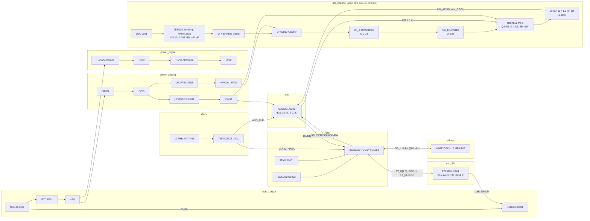

# Block diagram — dual_adc_10msps

Two ±10 V DC-coupled BNC inputs → 1 MΩ compensated ÷20 attenuator → FET buffer →
7-pole Butterworth anti-alias filter (2× Sallen-Key + FDA MFB + ADC RC) → dual simultaneous
12-bit ADC at 10 MSPS → Spartan-6 FPGA → 16 MB SDRAM capture buffer → FT232H sync-FIFO →
USB 2.0 HS (USB-C, power + data).

## Signal flow and data path

| Stage | Rate / level | Arithmetic |
|---|---|---|
| BNC input | ±10 V nominal, ±11.16 V = ADC full scale | 1.01 V / 0.09053 → 11.16 V |
| Attenuator node | ±0.4976 V | 49.9k / (953k + 49.9k) = 0.049756 |
| Buffer + SK_a + SK_b (unity DC) | peak ±1.11 V at SK_b out (1.23 MHz) | SK_b peak gain 2.24 × 0.4976 V; must stay < V+ − 2.5 V = +1.5 V (OPA810 JFET region) |
| FDA MFB | G = 1270/698 = 1.8195, Vod ±0.905 V | 0.049756 × 1.8195 = 0.09053 (−20.87 dB) |
| ADC | 2 ch × 10 MSPS × 12 bit, simultaneous (one CLK pin) | 20 MS/s total |
| FPGA → SDRAM | 20 MS/s × 16 bit = 40 MB/s | SDRAM 16 bit × 80 MHz = 160 MB/s peak, ~144 MB/s with page bursts → 3.6× margin |
| Capture depth | 16 MB = 8 M words → 4 M samples/ch | 4 M / 10 MSPS = 0.42 s ≥ 0.1 s (4.2× margin) |
| Upload | FT232H sync FIFO 60 MHz × 8 bit | 4 MB (0.1 s capture) at ~35 MB/s practical → ~0.12 s; full 16 MB ~0.46 s |

Capture-then-upload is the architecture; continuous streaming at full rate (40 MB/s) is not
promised. Streaming at ≤ 2 × 5 MSPS (20 MB/s) is a gateware option.

## Architecture options considered (data path)

| Option | Pros | Cons | Verdict |
|---|---|---|---|
| **A. FPGA (XC6SLX9) + SDR SDRAM + FT232H sync FIFO** | Deterministic 24-bit parallel capture, 4× memory margin, FT232H needs no firmware, all parts in JLC stock with KiCad symbols (FPGA via pin-compatible LX4-TQG144) | Gateware required (Verilog/VHDL), FPGA needs 1.2 V core + config flash | **Chosen** |
| B. STM32H7 + USB3300 ULPI + FMC SDRAM | One firmware toolchain | DCMI is ≤14 bit: cannot take 2×12 bit simultaneous; GPIO-DMA at 10 MHz × 24 bit contends with FMC SDRAM writes on the same bus matrix — timing not guaranteed; ULPI routing | Rejected |
| C. FX2LP (CY7C68013A) streaming, no memory | Few parts | 40 MB/s is at the practical HS bulk ceiling → drops samples; only 16 KB on-chip; not stocked at JLC | Rejected |
| D. Gowin GW1NR-9 (8 MB in-package PSRAM) + FT232H | No external SDRAM | No KiCad symbol, QFN-88 0.4 mm, proprietary PSRAM IP, 164 stock | Runner-up |

## Gateware / host software implied (out of board scope)

- Spartan-6 gateware (ISE 14.7 WebPACK, or open toolchains with limited S6 support): ADS5231
  serial init (SEL low pulse, then write reg 0x3 D1=1 to **disable the ADC PLL** — mandatory
  below 20 MSPS), 2×12-bit capture on CLK10 domain, software + level trigger with pre-trigger
  ring buffer, SDRAM controller (80 MHz from DCM_SP CLKFX M=8 D=1 — Spartan-6 PLL_BASE
  needs CLKIN ≥ 19 MHz, so use the DCM), FT245 sync-FIFO engine on FT_CLKOUT (60 MHz).
- FT232H EEPROM must be programmed once to "245 FIFO" mode (FT_Prog / ftdi_eeprom); host
  opens with FT_SetBitMode(0xFF, 0x40) for synchronous FIFO; D2XX or libftdi host app.
